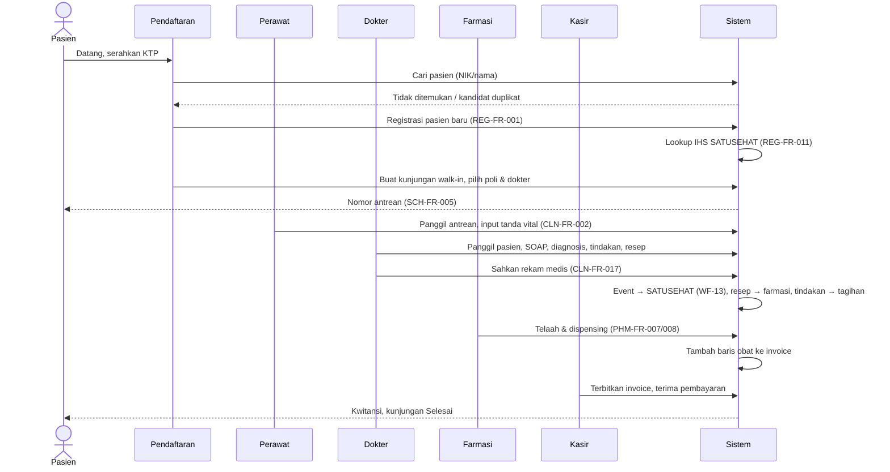

# Workflows — ClinicRME SaaS

| | |
|---|---|
| Versi | 1.0 — Disetujui (DEC-015) |
| Tanggal | 3 November 2026 |
| Stage | 1 |

Workflow yang ditandai `[REVIEW-MEDIS]` wajib direview tenaga medis sebelum gate Stage 9 (DEC-005).

| ID | Workflow | Prioritas |
|---|---|---|
| WF-01 | Pasien baru walk-in, umum — daftar sampai pulang | MVP |
| WF-02 | Pasien lama dengan appointment | MVP |
| WF-03 | Pasien asuransi | MVP |
| WF-04 | Pasien tanggungan perusahaan | MVP |
| WF-05 | Pembelian obat bebas tanpa kunjungan | MVP |
| WF-06 | Resep parsial & substitusi | MVP |
| WF-07 | Order & hasil lab | MVP |
| WF-08 | Pembatalan kunjungan / void invoice | MVP |
| WF-09 | Refund | MVP |
| WF-10 | Closing kasir | MVP |
| WF-11 | Koreksi rekam medis (addendum) | MVP |
| WF-12 | Rujukan keluar | MVP |
| WF-13 | Pengiriman SATUSEHAT | MVP |
| WF-14 | Onboarding tenant | MVP |
| WF-15 | Pasien mengakses data via Android | LJT |

---

## WF-01 — Pasien Baru Walk-in (Umum) `[REVIEW-MEDIS]`



**Status kunjungan:** `REGISTERED → ARRIVED → TRIAGED → IN_CONSULTATION → CONSULT_DONE → PHARMACY → BILLING → FINISHED`

**Pengecualian:**
| Kondisi | Penanganan |
|---|---|
| Kandidat duplikat ditemukan | Petugas memilih pasien yang ada atau melanjutkan membuat baru dengan alasan |
| Pasien tanpa NIK | Identitas alternatif (REG-FR-002); lookup IHS dilewati, ditandai untuk dilengkapi |
| SATUSEHAT tidak dapat dihubungi | Pelayanan tetap berjalan; pengiriman masuk antrean retry |
| Pasien pulang sebelum diperiksa | Kunjungan dibatalkan dengan alasan (WF-08) |
| Tidak ada resep | Langsung ke kasir |

**Titik audit:** registrasi, baca RM oleh dokter, pengesahan, dispensing, pembayaran.

**Diputuskan (DEC-013):** default farmasi → kasir; dapat dikonfigurasi per tenant.

---

## WF-02 — Pasien Lama dengan Appointment

1. Pasien/petugas membuat appointment pada slot dokter (SCH-FR-003).
2. Hari H: pasien datang, petugas check-in → nomor antrean (SCH-FR-006).
3. Petugas memverifikasi identitas & penjamin masih berlaku.
4. Lanjut seperti WF-01 mulai tahap perawat.

**Pengecualian:** terlambat melewati toleransi → antrean di belakang / dijadwal ulang; tidak datang → auto no-show (SCH-FR-011).

---

## WF-03 — Pasien Asuransi

1. Registrasi/check-in memilih penjamin Asuransi; petugas mencatat no. polis & memverifikasi eligibilitas (manual di MVP, OD-032).
2. Tarif mengikuti kategori penjamin (MST-FR-005).
3. Invoice dibagi: porsi penjamin (piutang) & porsi pasien (co-pay / di luar plafon) (BIL-FR-004).
4. Pasien membayar porsinya; porsi penjamin tercatat sebagai piutang (BIL-FR-013).
5. Pelunasan dari asuransi dicatat kemudian.

**Pengecualian:** eligibilitas ditolak → pasien dialihkan ke kategori Umum dengan persetujuan pasien.

---

## WF-04 — Pasien Tanggungan Perusahaan

Sama dengan WF-03, perbedaannya:
- Penjamin = perusahaan dengan kontrak tarif (MST-FR-006).
- Porsi perusahaan menjadi piutang; tagihan kolektif per periode (BIL-FR-014, LJT). Di MVP, piutang dicatat per invoice.

---

## WF-05 — Pembelian Obat Bebas tanpa Kunjungan

1. Farmasi membuat transaksi penjualan bebas (PHM-FR-012); pasien opsional (anonim diperbolehkan).
2. Sistem hanya mengizinkan obat golongan **bebas & bebas terbatas** tanpa resep.
3. Batch dipilih FEFO, stok dikurangi.
4. Kasir/farmasi menerima pembayaran → kwitansi.

---

## WF-06 — Resep Parsial & Substitusi `[REVIEW-MEDIS]`

**Parsial:**
1. Stok tidak cukup → apoteker menyerahkan sebagian; sisa tercatat "belum diambil".
2. Pasien kembali → sisa didispensing dari resep yang sama; tagihan menyesuaikan kebijakan (OD-063: ditagih penuh di awal atau sesuai yang diserahkan).

**Substitusi:**
1. Apoteker mengusulkan obat pengganti beserta alasan.
2. Dokter penulis resep menerima notifikasi di aplikasi → setuju/tolak.
3. Disetujui → resep diperbarui dengan jejak perubahan; dilanjutkan dispensing.
4. Dokter tidak tersedia → kebijakan klinik (OD-064).

---

## WF-07 — Order & Hasil Lab

```
Dokter membuat order lab (CLN-FR-014)
  → status ORDERED, nomor order
  → adapter mengirim ke aplikasi lab eksisting
  → lab memproses (di luar ClinicRME)
  → hasil diterima via adapter / input manual / unggah PDF (CLN-FR-015)
  → status RESULTED, dokter mendapat notifikasi
  → item lab masuk tagihan (bila lab milik klinik dan ditagih di kasir — OD-065)
```

---

## WF-08 — Pembatalan Kunjungan / Void Invoice

| Kasus | Alur |
|---|---|
| Kunjungan belum ada tindakan klinis | Petugas membatalkan dengan alasan; tidak perlu persetujuan |
| Kunjungan sudah ada RM disahkan | Tidak dapat dibatalkan; hanya invoice yang dapat di-void |
| Invoice belum dibayar | Kasir mengajukan void → manajer menyetujui → invoice baru bila perlu |
| Invoice sudah dibayar | Harus melalui refund (WF-09) dulu |

---

## WF-09 — Refund

1. Kasir mengajukan refund: pembayaran asal, nominal, alasan.
2. Di bawah ambang → kasir senior/manajer menyetujui; di atas ambang → manajer/owner (OD-041).
3. Disetujui → dokumen refund terbit; metode pengembalian dicatat (tunai / via gateway).
4. Pembayaran asal tidak diubah; saldo invoice dihitung ulang.
5. Masuk laporan transaksi tidak wajar bila memenuhi aturan (BIL-FR-016).

---

## WF-10 — Closing Kasir

1. Kasir membuka shift dengan modal awal.
2. Semua pembayaran dalam shift terhubung ke shift tersebut.
3. Akhir shift: kasir menghitung kas fisik per pecahan → sistem menghitung selisih terhadap ekspektasi tunai.
4. Non-tunai (QRIS, debit) dicocokkan dengan laporan sistem.
5. Selisih di atas toleransi wajib diberi keterangan; manajer memverifikasi.
6. Laporan closing dicetak/tersimpan (RPT-FR-004).

---

## WF-11 — Koreksi Rekam Medis (Addendum) `[REVIEW-MEDIS]`

1. Dokter membuka catatan yang sudah disahkan → pilih "Tambah addendum".
2. Isi koreksi & alasan → sahkan addendum.
3. Catatan asli tetap utuh; tampilan menunjukkan catatan + addendum berurutan.
4. Bila mengubah data yang sudah dikirim ke SATUSEHAT → update resource (INT-FR-012).

---

## WF-12 — Rujukan Keluar `[REVIEW-MEDIS]`

1. Dokter memilih "Rujuk" pada encounter: tujuan (faskes, poli/spesialis), alasan, diagnosis, ringkasan klinis.
2. Sistem membuat surat rujukan PDF bernomor (CLN-FR-022).
3. Rujukan BPJS online → Lanjutan (BPJ-FR-003).

---

## WF-13 — Pengiriman SATUSEHAT

```
RM disahkan → domain event → outbox
  → worker: urutkan dependensi (Patient/IHS → Encounter → Condition/Observation/Procedure → Medication*)
  → validasi payload → kirim
  → sukses: simpan ID SATUSEHAT
  → gagal sementara: retry backoff
  → gagal permanen: dead-letter + notifikasi admin → perbaiki data → kirim ulang
```

---

## WF-14 — Onboarding Tenant

1. Platform admin membuat tenant: tipe, paket, nama, kontak (PLT-FR-001).
2. Tenant admin menerima undangan → login (Google/email) → set MFA.
3. Wizard setup: profil klinik → cabang & poli → tenaga kesehatan → layanan & tarif → obat (impor) → user & role → kredensial SATUSEHAT.
4. Checklist siap operasional ditampilkan sampai lengkap.

---

## WF-15 — Pasien Mengakses Data via Android (Lanjutan)

1. Pasien mengunduh aplikasi → daftar dengan nomor HP/Google.
2. Penautan ke klinik: masukkan kode klinik / pindai QR → OTP ke nomor terdaftar di klinik.
3. Pasien melihat data yang sudah disahkan; wali menautkan anak dengan verifikasi tambahan.

---

## Open Decision Baru dari Workflow

| ID | Pertanyaan |
|---|---|
| OD-063 | Resep parsial: obat ditagih penuh di awal atau sesuai jumlah yang diserahkan? |
| OD-064 | Substitusi saat dokter penulis resep tidak tersedia: siapa yang boleh menyetujui? |
| OD-065 | Pemeriksaan lab ditagih oleh kasir klinik atau oleh lab sendiri? |
