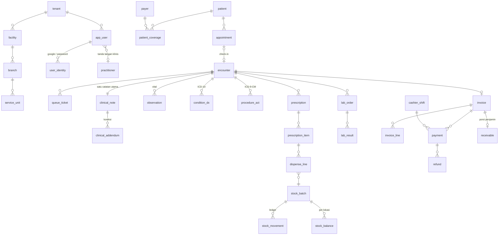

# Database Design — ClinicRME SaaS

| | |
|---|---|
| Versi | 1.0 — Disetujui (DEC-018) |
| Tanggal | 3 November 2026 |
| DBMS | PostgreSQL 16 (Cloud SQL) |
| Sumber kebenaran | Sejak Stage 4: **`db/migrations/`** (diterapkan `pnpm db:migrate`). `db/schema/*.sql` = desain Stage 2–3, dibekukan; kesetaraan dicek `pnpm check:schema` (usulan OD-071) |
| Detail kolom | [DATA_DICTIONARY.md](DATA_DICTIONARY.md) (dibangkitkan otomatis) |
| ADR terkait | ADR-0002, 0005, 0006, 0007, 0013 |

## 1. Ringkasan

| Metrik | Nilai |
|---|---|
| Tabel | 89 (82 ber-`tenant_id`, 7 global) |
| Tabel dengan RLS | 78 (semua tabel tenant non-platform + `tenant`) |
| Uji keamanan skema | 42 pemeriksaan lulus — [bukti](../reports/stage-2/evidence/db_security_tests.txt) |

## 2. File Skema

| File | Modul | Tabel utama |
|---|---|---|
| `000_foundation.sql` | Fondasi | role DB, skema `app`, `current_tenant_id()`, helper RLS & trigger |
| `010_platform.sql` | Platform (Stage 5) | `tenant`, `subscription_plan`, `tenant_subscription`, `support_access_grant`, `tenant_export_job` |
| `020_iam.sql` | IAM (Stage 3, 6) | `app_user`, `user_identity`, `user_credential`, `user_mfa`, `user_invitation`, `role`, `user_session`, `permission`, `menu_item` |
| `025_auth_functions.sql` | Auth pra-sesi (Stage 3) | `resolve_tenant(code)`, `resolve_session(token_hash)` — `SECURITY DEFINER`, satu-satunya jalan baca sebelum tenant context ada; `user_session` menyimpan `token_hash` (SHA-256), bukan token |
| `030_audit.sql` | Audit (Stage 3) | `audit_log` (partisi bulanan), `audit_chain_head`, `write_audit()`, `verify_audit_chain()` |
| `040_masterdata.sql` | Master (Stage 7) | `facility`, `branch`, `service_unit`, `practitioner`, `payer`, `service_item`, `tariff`, `uom`, `supplier`, `document_sequence`, `queue_counter`, `region` |
| `045_terminology.sql` | Terminologi (Stage 7) | `code_system`, `concept`, `tenant_concept_favorite` |
| `050_patient.sql` | Pasien (Stage 8) | `patient`, `patient_contact`, `patient_coverage`, `consent_document`, `patient_consent` |
| `060_scheduling.sql` | Jadwal (Stage 8) | `practitioner_schedule`, `schedule_exception`, `appointment`, `encounter`, `queue_ticket` |
| `065_drug_master.sql` | Obat (Stage 10) | `drug_item`, `drug_price` |
| `070_clinical.sql` | Klinis (Stage 9) | `clinical_note`, `clinical_addendum`, `observation`, `allergy_intolerance`, `condition_dx`, `procedure_act`, `prescription(_item)`, `lab_order`, `lab_result`, `medical_document`, `referral`, `stored_file` |
| `080_pharmacy.sql` | Farmasi (Stage 10) | `stock_batch`, `stock_movement`, `stock_balance`, `goods_receipt`, `dispense`, `otc_sale`, `stock_adjustment`, `stock_opname` |
| `090_billing.sql` | Billing (Stage 11) | `cashier_shift`, `invoice`, `invoice_line`, `payment`, `payment_gateway_txn`, `refund`, `invoice_void`, `receivable` |
| `100_integration.sql` | Integrasi (Stage 12) | `outbox_event`, `integration_connection`, `fhir_sync_record`, `integration_dead_letter` |
| `900_security.sql` | Keamanan | aktivasi RLS massal, grants, trigger `touch_row`, `search_path` fungsi |

## 3. Diagram Entitas Inti

## 4. Konvensi

| Aspek | Aturan |
|---|---|
| Penamaan | `snake_case`, tunggal (`patient`, bukan `patients`) |
| PK | `uuid` (UUIDv7 dari aplikasi; default `gen_random_uuid()`) |
| Tenant | Kolom `tenant_id uuid NOT NULL`; `UNIQUE (tenant_id, id)` |
| Relasi antar tabel tenant | **FK komposit** `(tenant_id, x_id) → x(tenant_id, id)` — referensi lintas tenant mustahil walau ada bug aplikasi (uji T04) |
| Kolom audit baris | `created_at`, `created_by`, `updated_at`, `updated_by`, `version` (dikelola trigger `touch_row`) |
| Status | `text` + `CHECK (status IN (...))` — lebih mudah dimigrasi daripada enum |
| Uang | `numeric(18,2)`; kuantitas `numeric(18,4)` |
| Waktu | `timestamptz` (UTC); tanggal bisnis `date` |
| Data sensitif | NIK: `*_encrypted bytea` (enkripsi aplikasi) + `*_hash` (HMAC) untuk pencarian |
| Hapus | Master: `is_active = false`. Klinis & transaksi: tidak dihapus (ADR-0006) |

## 5. Aturan Bisnis yang Ditegakkan di Database

| Aturan | Mekanisme | Requirement | Uji |
|---|---|---|---|
| Isolasi tenant | RLS + FORCE + fail-closed | GEN-FR-001 | T01–T06 |
| Referensi lintas tenant | FK komposit | GEN-FR-001 | T04 |
| Catatan disahkan tidak berubah | Trigger `guard_clinical_note` | CLN-FR-017 | T08, T08b |
| Data klinis encounter terkunci setelah sah | Trigger `guard_encounter_clinical_child` | CLN-FR-017 | T08c, T08d |
| Satu diagnosis primer | Unique partial index | CLN-FR-008 | T07 |
| Pengesahan butuh penandatangan & hash | CHECK | CLN-FR-017/018 | T07b |
| Addendum, pembayaran, ledger stok append-only | Revoke + trigger | GEN-FR-003 | T09, T12, T16b |
| Stok tidak negatif | CHECK `qty_on_hand >= 0` via trigger ledger | PHM-FR-013 | T11 |
| Batch kedaluwarsa tidak keluar | Trigger `apply_stock_movement` | PHM-FR-013 | T11b |
| Obat keras tidak dijual bebas | Trigger `guard_otc_drug_class` | PHM-FR-012 | T13 |
| Saldo stok = ledger | Trigger | PHM-FR-004 | T10, T10b |
| Total baris & invoice konsisten | CHECK | BIL-FR-001/004 | T14 |
| Invoice terbit tidak berubah | Trigger `guard_invoice` | BIL-FR-002/009 | T15, T15b |
| Pembayaran tidak tercatat ganda | Unique `idempotency_key` | BIL-FR-006 | T16 |
| Invoice lunas tidak bisa di-void | Trigger | BIL-FR-009 | T17 |
| Maker–checker refund/void/penyesuaian | CHECK `approved_by <> requested_by` | BIL-FR-010, PHM-FR-016 | T18 |
| Keputusan refund final | Trigger `guard_decided_request` | BIL-FR-010 | T18b |
| Periode tarif tidak tumpang tindih | Exclusion constraint (btree_gist) | MST-FR-005 | T19 |
| Audit tidak dapat ditulis/diubah langsung | Revoke + SECURITY DEFINER | AUD-FR-003 | T20, T20b |
| Manipulasi audit terdeteksi | Hash chain + `verify_audit_chain` | AUD-FR-003 | T21, T22 |
| Nomor dokumen atomik | `next_document_number()` | GEN-FR-006 | T14b |
| Satu shift kasir terbuka | Unique partial index | BIL-FR-011 | — |
| Antrean unik per hari | Unique constraint | SCH-FR-007 | — (uji konkurensi di Stage 8) |

| Mesin status tenant (TERMINATED final, hanya dari SUSPENDED) | Trigger `trg_tenant_status_transition` (migrasi 0003) | PLT-FR-005 | T28, P07, P10 |
| Kuota paket: user aktif & cabang aktif | Trigger `trg_quota_users`/`trg_quota_branches`, kunci baris tenant (migrasi 0003) | PLT-FR-004 | P16, T30; mutasi M9 |
| Profil klinik hanya kolom profil, hanya tenant sendiri | GRANT kolom + policy `tenant_self_update` (migrasi 0004) | PLT-FR-007 | T31, K03 |
| Satu ekspor aktif per tenant | Unique partial index `ux_tenant_export_active` | PLT-FR-008 | T32b, K04 |
| Kode tenant tercadang (`admin`, `api`, `www`, …) | Constraint `tenant_code_not_reserved` | CR-0001 | T29 |
| Provisioning atomik (tenant + langganan + role + undangan + audit) | `app.provision_tenant()` SECURITY DEFINER, hanya `clinicrme_platform` | PLT-FR-001/002 | P08, P09, T27d, T29b |

Aturan yang **tidak** ditegakkan di DB dan menjadi tanggung jawab aplikasi: permission & cabang (IAM), validasi alergi/duplikasi obat, pemilihan batch FEFO, batas diskon, aturan no-show. Pengecualian SQLSTATE kustom (`CRQ01` kuota, `CRS01` status, `CRP01` provisioning) dipetakan ke problem `PLT-403-QUOTA`/`PLT-409-STATUS`/`PLT-400-*` oleh `ProblemFilter`.

## 6. Role Database

| Role | Hak | Catatan |
|---|---|---|
| owner (migrasi) | DDL | Hanya pipeline migrasi |
| `clinicrme_app` | DML tabel tenant (RLS), SELECT tabel global, EXECUTE fungsi | Tanpa UPDATE/DELETE untuk tabel append-only; tanpa akses tulis audit |
| `clinicrme_readonly` | SELECT (RLS berlaku) kecuali kredensial | Reporting |
| `clinicrme_platform` | Tabel platform (`tenant`, langganan, histori status, flag, `platform_*`), EXECUTE `provision_tenant` & `write_audit`; tanpa DELETE | Tidak dapat membaca data klinis (PLT-FR-009) — dicek katalog T27 |

Migrasi 0003 juga menambah policy `tenant_definer` untuk pemilik migrasi: `tenant` memakai FORCE RLS, sehingga fungsi SECURITY DEFINER (`resolve_tenant`, `provision_tenant`, trigger kuota) tetap bekerja bila pemilik bukan superuser (mis. Cloud SQL). Di lokal/CI pemiliknya superuser, jadi celah ini sebelumnya tidak terlihat.

## 7. Indeks & Performa

| Kebutuhan | Indeks |
|---|---|
| Cari pasien nama toleran salah ketik (REG-FR-003) | GIN `pg_trgm` pada `patient.full_name` |
| Cari NIK / deteksi duplikat (REG-FR-004) | Unique `(tenant_id, nik_hash)` |
| Worklist dokter (CLN-FR-001) | `encounter(tenant_id, branch_id, practitioner_id, status, arrived_at)` |
| Riwayat pasien (CLN-FR-016) | `encounter(tenant_id, patient_id, arrived_at DESC)` |
| Pencarian ICD (TRM-FR-004) | GIN trigram `concept.display_id` |
| Audit per pasien (AUD-FR-004) | `audit_log(tenant_id, patient_id, occurred_at)` |
| Outbox | Partial index `status = 'PENDING'` |

Tabel dengan pertumbuhan besar: `audit_log` (partisi bulanan), `observation`, `stock_movement`, `outbox_event` (dibersihkan > 30 hari). Rencana partisi tambahan dievaluasi di Stage 15 berdasarkan load test.

## 8. Retensi

- Data rekam medis disimpan ≥ 25 tahun sejak kunjungan terakhir (NFR-RET-001, REG-03). Tidak ada `DELETE` pada tabel klinis.
- Pengarsipan (pindah ke storage dingin) dirancang di Stage 15; skema tetap sama.

## 9. Batasan & Tindak Lanjut

| Item | Rencana |
|---|---|
| Partisi `audit_log` bulanan dibuat oleh job | ✅ migrasi 0002 `ensure_audit_partitions` + job worker harian `system.audit_partitions` (T26) |
| Enkripsi NIK & HMAC key management | Stage 3 (KMS) |
| Terjemahan ke skema Drizzle + migrasi awal | ✅ Stage 4: migrasi 0000–0001, diff nol ([bukti](../reports/stage-4/evidence/schema_parity.txt)); skema TypeScript Drizzle (introspeksi) dibuat saat modul pertama memakainya (Stage 5) |
| Uji konkurensi (antrean, nomor dokumen, dispensing bersamaan) | ✅ nomor dokumen: 50 transaksi paralel unik & tanpa celah (C01–C04) · antrean: Stage 8 · dispensing: Stage 10 |
| Indeks untuk laporan | Stage 14 berdasarkan query aktual |
