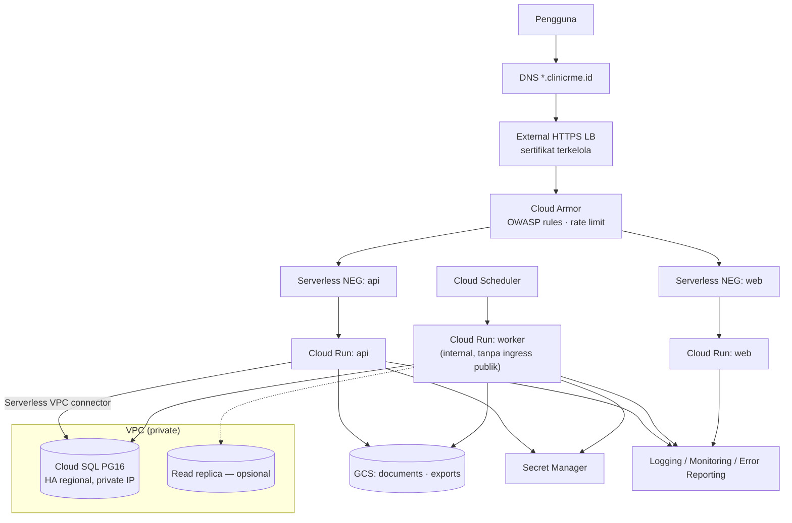

# Deployment Architecture — ClinicRME SaaS

| | |
|---|---|
| Versi | 1.0 — Disetujui (DEC-018) |
| Tanggal | 4 November 2026 |
| ADR | ADR-0011 (Terraform), ADR-0012, ADR-0013 |
| Target | NFR-AVL-001 99,5% · RPO ≤ 15 menit · RTO ≤ 4 jam (DEC-014) |

## 1. Lingkungan

| Lingkungan | GCP project | Data | Deploy | SATUSEHAT / gateway |
|---|---|---|---|---|
| local | — (Docker Compose) | Sintetis | Manual | Mock |
| dev | `clinicrme-dev` | Sintetis | Otomatis dari `main` | Sandbox |
| staging | `clinicrme-staging` | Sintetis / anonim | Tag rilis, persetujuan manual | Sandbox |
| prod | `clinicrme-prod` | Nyata | Image yang sama dengan staging, persetujuan manual | Production |

Region: `asia-southeast2` (Jakarta). Persyaratan lokasi data diverifikasi di OD-049.

## 2. Topologi Produksi



## 3. Komponen & Konfigurasi Awal

| Komponen | Konfigurasi usulan | Catatan |
|---|---|---|
| Cloud Run `api` | 1 vCPU / 1 GiB, concurrency 40, min 1, max 10 | Max instance membatasi biaya & koneksi DB |
| Cloud Run `worker` | 1 vCPU / 1 GiB, min 1, max 3, ingress internal | Puppeteer/PDF butuh memori lebih → evaluasi Stage 9 |
| Cloud Run `web` | 1 vCPU / 512 MiB, min 0–1, max 5 | |
| Cloud SQL | PostgreSQL 16, HA, PITR, private IP, `max_connections` ≥ (10+3) × pool 10 + cadangan | Ukuran mesin ditentukan dari load test (Stage 15) |
| Service account | Satu per layanan, least privilege | `api` tidak punya akses Terraform/IAM |
| Secret | DB password, HMAC NIK key, kunci enkripsi (via KMS), OAuth client Google, kredensial SATUSEHAT/gateway | Rotasi terjadwal |
| Bucket | `documents` (versioning, retention, lifecycle ke Coldline/Archive), `exports` (hapus otomatis 7 hari) | Uniform access, tanpa publik |

## 4. Pipeline Rilis

```
PR → CI (lint, typecheck, unit, integration + db/tests, openapi diff, scan)
main → build image (digest) → Artifact Registry → deploy dev → smoke test
tag vX.Y.Z → deploy staging (approval) → UAT / regression
           → deploy prod (approval): migrasi DB → Cloud Run revisi baru 10% → 50% → 100%
rollback  → alihkan traffic ke revisi sebelumnya (migrasi bersifat expand-only)
```

Migrasi DB dijalankan oleh **Cloud Run Job** terpisah dengan role owner, sebelum revisi aplikasi baru menerima traffic. Aturan *expand → migrate → contract* menjaga dua versi aplikasi tetap kompatibel dengan skema.

## 5. Backup & Disaster Recovery

| Lapisan | Mekanisme | Memenuhi |
|---|---|---|
| Database | Backup otomatis harian (retensi 30 hari) + **PITR** (WAL) 7 hari | RPO ≤ 15 menit (PITR praktis ~detik–menit) |
| Database — zona | HA regional (failover otomatis antar zona) | Ketersediaan |
| Database — region | Ekspor terjadwal / replica lintas region (dievaluasi biaya di Stage 15) | DR region |
| Dokumen | Object versioning + retention policy | Cegah hapus/timpa |
| Konfigurasi | Terraform state (GCS, versioning) | Bangun ulang lingkungan |
| Secret | Secret Manager versioning | — |

### Skenario & RTO

| Skenario | Pemulihan | Target |
|---|---|---|
| Instance Cloud Run gagal | Otomatis | Menit |
| Zona gagal | Failover HA Cloud SQL | < 5 menit |
| Data rusak oleh bug / salah operasi | PITR ke instance baru → verifikasi → alihkan | ≤ 4 jam |
| Region tidak tersedia | Terraform di region lain + restore backup/ekspor terbaru | ≤ 4 jam bila replica lintas region tersedia; tanpa itu bisa lebih lama — keputusan biaya Stage 15 |
| Kredensial bocor | Rotasi secret, cabut sesi, incident response | Sesuai INCIDENT_RESPONSE_PLAN |

**Uji restore** bulanan ke project terpisah; hasil dicatat (waktu restore, integritas audit chain via `verify_audit_chain`). Gate Stage 15 mensyaratkan uji restore lulus dalam RTO.

## 6. Prosedur Downtime Klinik (NFR-DR-003)

1. Klinik menerima notifikasi gangguan di status page.
2. Pelayanan memakai formulir cadangan (cetak: registrasi, SOAP ringkas, resep, kwitansi manual bernomor).
3. Setelah pulih, data diinput ulang dengan penanda "input pasca-gangguan" dan waktu kejadian asli.
4. Detail ditetapkan di SOP operasional (Stage 16).

## 7. Biaya (gambaran, divalidasi Stage 15)

Pendorong biaya utama: Cloud SQL HA (terbesar), Cloud Run min instance, Load Balancer + Cloud Armor, egress, penyimpanan dokumen jangka panjang, log. Kontrol: budget alert 50/80/100%, max instance, retensi log, lifecycle storage (RSK-005).

## 8. Observability

| Sinyal | Implementasi |
|---|---|
| Log | JSON terstruktur (`request_id`, `tenant_id`, `user_id`, tanpa PHI) |
| Trace | OpenTelemetry → Cloud Trace |
| Metrik | Latensi p95 per endpoint, error rate, antrean outbox, koneksi DB, status SATUSEHAT per tenant |
| Alert | p95 > 500 ms 10 menit; error 5xx > 2%; outbox tertunda > 15 menit; uptime check gagal; budget |
| Uptime | Cloud Monitoring uptime check `/healthz` & `/readyz` |
