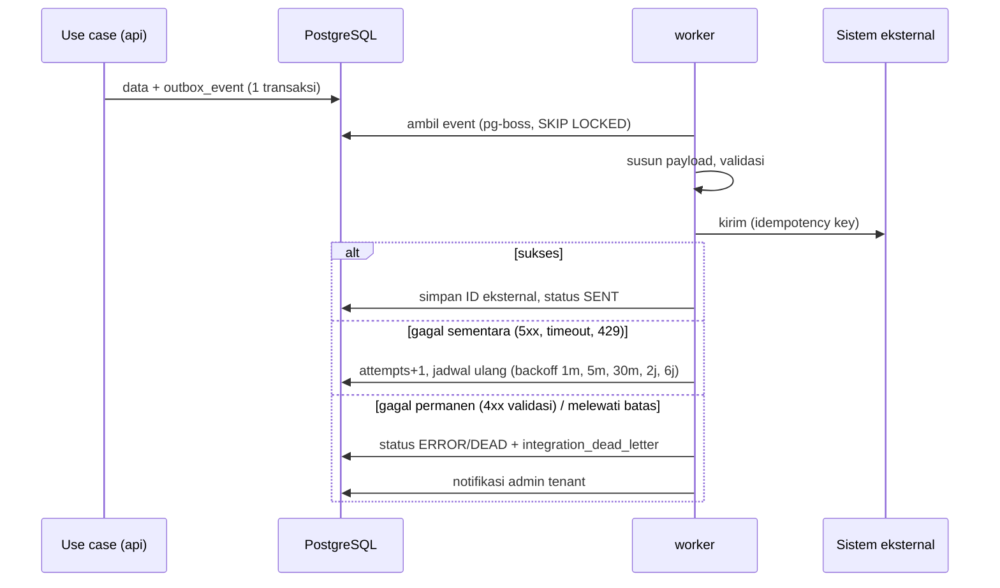

# Integration Architecture — ClinicRME SaaS

| | |
|---|---|
| Versi | 1.0 — Disetujui (DEC-018) |
| Tanggal | 4 November 2026 |
| ADR | ADR-0004 |

## 1. Prinsip

1. **Outbox dulu, kirim kemudian.** Tidak ada panggilan ke sistem eksternal di dalam transaksi pengguna.
2. **Idempoten.** Setiap pengiriman memakai kunci = `outbox_event.id` atau ID lokal resource.
3. **Gagal tidak menghentikan pelayanan.** SATUSEHAT/lab/notifikasi down → pelayanan klinik tetap berjalan; data menunggu di antrean.
4. **Terlihat.** Status setiap pengiriman tercatat (`fhir_sync_record`, `lab_order.status`, `payment_gateway_txn.status`) dan tampil di dashboard.
5. **Rahasia di Secret Manager.** `integration_connection.secret_ref` hanya menyimpan nama secret.
6. **Adapter terisolasi.** Setiap sistem eksternal punya adapter sendiri di `libs/integration/<sistem>`; perubahan spesifikasi tidak menyentuh modul domain.

## 2. Pola Umum

## 3. SATUSEHAT

| Aspek | Desain |
|---|---|
| Autentikasi | OAuth2 client credentials per fasilitas; token di-cache di memori worker sampai kedaluwarsa − 60 detik |
| Lingkungan | `SANDBOX` (dev/staging) dan `PRODUCTION`; satu `integration_connection` per fasilitas per lingkungan |
| Pemicu | `PatientRegistered` (lookup IHS), `EncounterArrived`, `EncounterSigned`, `PrescriptionIssued`, `MedicationDispensed`, `AddendumSigned` |
| Urutan dependensi | Organization/Location/Practitioner (setup) → Patient IHS → Encounter → Condition, Observation, Procedure → MedicationRequest → MedicationDispense |
| Penundaan dependensi | Bila resource induk belum terkirim, job anak dijadwal ulang (bukan gagal) |
| Validasi | Skema Zod per resource + aturan profil SATUSEHAT; HL7 FHIR Validator dijalankan di CI terhadap payload contoh |
| Koreksi | Addendum → update resource terkait (INT-FR-012) |
| Rekonsiliasi | Job harian: kunjungan `SIGNED` tanpa `fhir_sync_record` `SENT` → laporan (INT-FR-011) |
| Batas laju | Antrean per tenant dengan concurrency terbatas agar tidak membanjiri SATUSEHAT |

Mapping detail resource → `docs/04-interoperability/FHIR_MAPPING.md` (Stage 12). Daftar resource wajib dikonfirmasi ulang terhadap ketentuan SATUSEHAT terbaru saat Stage 12 dimulai (OD-042).

## 4. Aplikasi Lab Eksisting

| Aspek | Desain |
|---|---|
| Kontrak internal | Interface `LabConnector { sendOrder(order): ExternalRef; fetchResults(ref) / onResultWebhook(payload) }` |
| Implementasi | Satu adapter per vendor (OD-059); adapter `ManualLab` sebagai fallback (input/unggah hasil) |
| Format | Mengikuti vendor: REST/JSON, HL7 v2 (ORM/ORU), atau FHIR (ServiceRequest/DiagnosticReport) |
| Pencocokan | `lab_order.order_no` dikirim ke vendor dan wajib kembali di hasil |
| Hasil masuk | Webhook vendor (diverifikasi) atau polling terjadwal |

## 5. Payment Gateway QRIS

| Aspek | Desain |
|---|---|
| Buat tagihan | Sinkron dari `api` (kasir menunggu QR) dengan idempotency key; timeout 10 detik |
| Callback | `POST /api/integrations/payment-gateway/callback` → verifikasi signature → cari `payment_gateway_txn` → cek nominal → buat `payment` dengan `idempotency_key = provider_ref` |
| Callback tidak datang | Job menanyakan status ke provider setiap 30 detik sampai QR kedaluwarsa |
| Rekonsiliasi | Job harian mencocokkan settlement report dengan `payment_gateway_txn` (BIL-FR-012) |
| Vendor | OD-039 (biaya & kontrak perlu persetujuan PO) |

## 6. Notifikasi

| Kanal | MVP | Isi |
|---|---|---|
| Email | Undangan user, reset password (NTF-FR-001) | Tanpa data medis |
| WhatsApp/SMS | Lanjutan — pengingat appointment | Tanpa data medis |
| Push (Android) | Lanjutan | "Ada informasi baru dari Klinik X" |

Provider: OD-012.

## 7. Google Sign-In

Bukan integrasi asinkron: dipanggil langsung oleh `api` saat login (ADR-0003). Kegagalan Google → pengguna tetap dapat login dengan email + password.

## 8. Monitoring Integrasi

| Metrik | Alert |
|---|---|
| Event outbox `PENDING` > 15 menit | Peringatan |
| Rasio error SATUSEHAT per tenant > 5% / jam | Peringatan ke admin tenant & platform |
| Dead-letter baru | Notifikasi admin tenant |
| Callback QRIS dengan signature invalid | Alert keamanan |
| Kunjungan disahkan belum terkirim > 24 jam | Masuk laporan rekonsiliasi |
