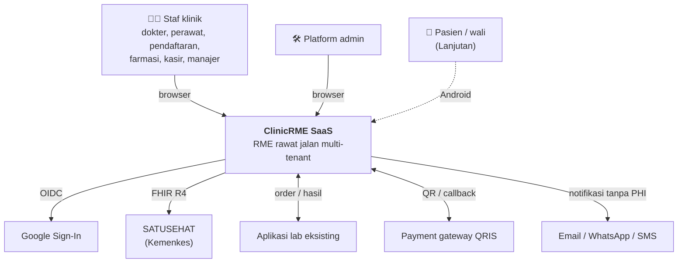
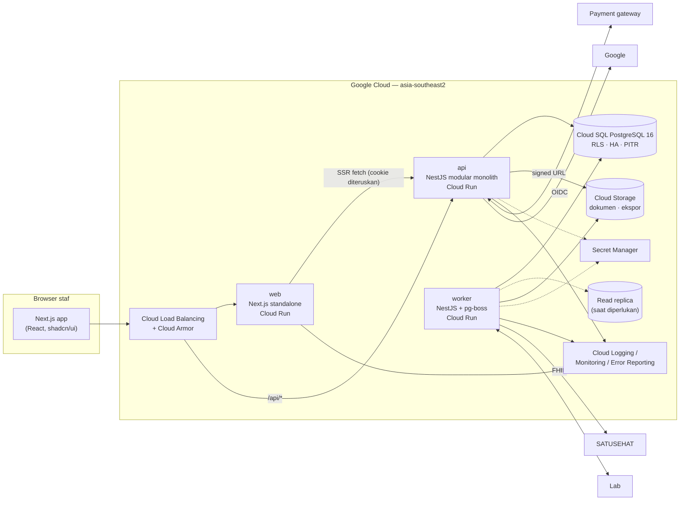
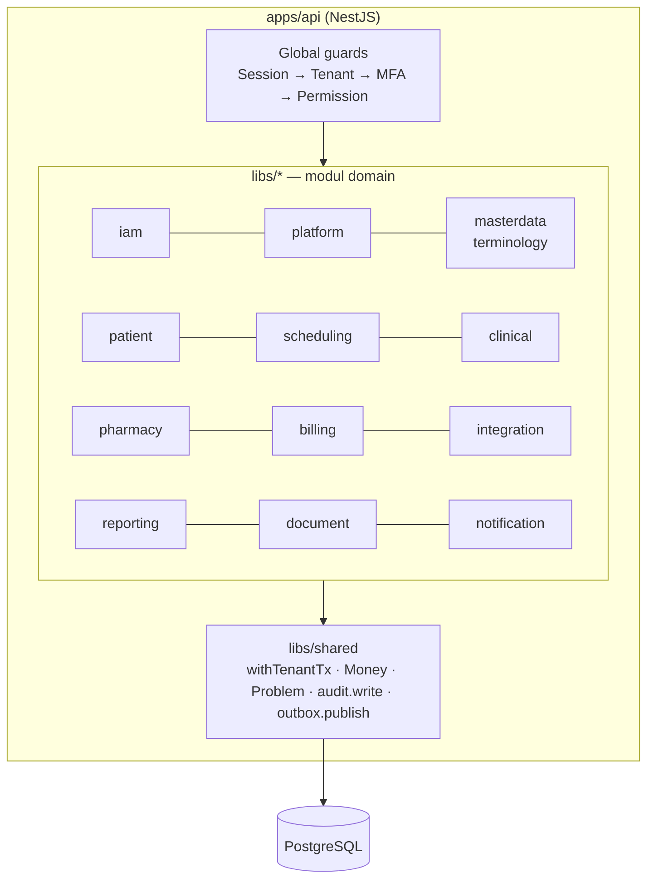
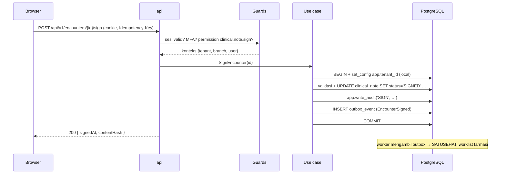

# System Architecture — ClinicRME SaaS

| | |
|---|---|
| Versi | 1.0 — Disetujui (DEC-018) |
| Tanggal | 4 November 2026 |
| Model | C4 (Context, Container, Component) |
| ADR | ADR-0001 s.d. ADR-0013 |

## 1. Context (C4 Level 1)

## 2. Container (C4 Level 2)

| Container | Teknologi | Tanggung jawab | Skala awal |
|---|---|---|---|
| `web` | Next.js (App Router), TanStack Query, shadcn/ui | UI staf & konsol platform; **tidak** mengakses DB | min 0–1, max 5 |
| `api` | NestJS, Drizzle, Zod | Semua use case sinkron, otorisasi, audit, tulis outbox | min 1, max 10 |
| `worker` | NestJS standalone, pg-boss | Outbox, SATUSEHAT, lab, PDF, export, job terjadwal (no-show, partisi audit, verifikasi chain, rekonsiliasi) | min 1, max 3 |
| PostgreSQL | Cloud SQL 16 | Data, RLS, trigger integritas, antrean pg-boss | HA regional |
| Cloud Storage | GCS | Dokumen medis, unggahan, ekspor | — |

## 3. Component — `api` (C4 Level 3)

**Aturan dependensi antar modul** (ditegakkan `@nx/enforce-module-boundaries`):

| Modul | Boleh bergantung pada |
|---|---|
| `shared` | — |
| `iam`, `platform`, `audit` | `shared` |
| `masterdata`, `terminology` | `shared`, `iam` |
| `patient` | `shared`, `iam`, `masterdata` |
| `scheduling` | + `patient` |
| `clinical` | + `scheduling`, `terminology`, `document` |
| `pharmacy` | + `clinical` (public API resep saja), `billing` (public API tambah baris) |
| `billing` | `shared`, `iam`, `masterdata`, `patient` |
| `integration` | membaca modul lain hanya melalui public API & event; tidak ada yang bergantung pada `integration` |
| `reporting` | baca-saja via view/query khusus; tidak dipanggil modul lain |

Efek yang wajib konsisten dalam satu transaksi (mis. dispensing → baris invoice) dipanggil **sinkron** lewat public API modul. Efek eksternal lewat **outbox** (ADR-0004).

## 4. Alur Request

## 5. Keputusan Arsitektur

| ADR | Keputusan |
|---|---|
| [0001](ADR/ADR-0001-tech-stack.md) | NestJS + Next.js + PostgreSQL, Nx monorepo |
| [0002](ADR/ADR-0002-multi-tenancy-rls.md) | Shared schema + RLS |
| [0003](ADR/ADR-0003-authentication.md) | Google OIDC + email/password di NestJS |
| [0004](ADR/ADR-0004-outbox-and-integration.md) | Transactional outbox + pg-boss; tanpa FHIR API publik di MVP |
| [0005](ADR/ADR-0005-ids-and-document-numbers.md) | UUIDv7 + nomor dokumen atomik |
| [0006](ADR/ADR-0006-immutable-records.md) | Immutability di aplikasi & DB |
| [0007](ADR/ADR-0007-audit-hash-chain.md) | Audit hash chain |
| [0008](ADR/ADR-0008-openapi-code-first.md) | OpenAPI design-first di Stage 2, code-first mulai Stage 4 |
| [0009](ADR/ADR-0009-repository-layout.md) | Layout repository |
| [0010](ADR/ADR-0010-ui-library.md) | shadcn/ui + Tailwind + Recharts |
| [0011](ADR/ADR-0011-iac-terraform.md) | Terraform |
| [0012](ADR/ADR-0012-reporting-read-replica.md) | Laporan di DB utama dulu; read replica saat perlu |
| [0013](ADR/ADR-0013-document-storage.md) | Cloud Storage + signed URL |

## 6. Atribut Kualitas → Taktik

| NFR | Taktik |
|---|---|
| NFR-SEC-001 isolasi | 8 lapis kontrol ([TENANT_ISOLATION.md](TENANT_ISOLATION.md)) |
| NFR-PERF-001 p95 < 500 ms | Pekerjaan berat di worker; index sesuai query utama; connection pooling |
| NFR-PERF-002 cari pasien | Trigram + hash NIK |
| NFR-AVL-001 99,5% | Cloud Run multi-instance, Cloud SQL HA, deploy rolling |
| NFR-DR-001/002 | PITR, backup harian, uji restore bulanan ([DEPLOYMENT_ARCHITECTURE.md](DEPLOYMENT_ARCHITECTURE.md)) |
| NFR-AUD-001 | `write_audit` dalam transaksi use case + audit READ asinkron |
| NFR-OPS-003 biaya | Max instance, budget alert, min instance 0 untuk web |
