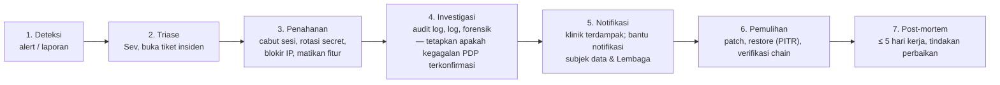

# Incident Response Plan — ClinicRME SaaS

| | |
|---|---|
| Versi | 0.1 — DRAFT (Stage 3) |
| Tanggal | 4 November 2026 |
| Dasar | UU 27/2022 Pasal 46; PP 33/2026 Pasal 114–118; DPA klinik |

> Bukan nasihat hukum. Kewajiban notifikasi ke subjek data dan Lembaga ada pada **pengendali (klinik)**; ClinicRME sebagai **prosesor** wajib segera memberi tahu klinik dan membantu.

## 1. Klasifikasi

| Sev | Definisi | Contoh | Respons awal |
|---|---|---|---|
| **Sev-1** | Kebocoran/akses tidak sah ke data pribadi, atau layanan mati luas pada jam praktik | Data lintas tenant terbaca; DB terekspos; ransomware | ≤ 30 menit, 24/7 |
| **Sev-2** | Dugaan kebocoran terbatas, integritas terganggu, atau gangguan fitur kritis | Hash chain audit rusak; akun admin diambil alih; SATUSEHAT gagal massal | ≤ 2 jam |
| **Sev-3** | Kelemahan keamanan tanpa bukti eksploitasi; gangguan minor | Dependency kritis rentan; satu tenant tidak bisa login | ≤ 1 hari kerja |

## 2. Peran

| Peran | Tanggung jawab | Saat ini |
|---|---|---|
| Incident Commander (IC) | Memimpin respons, keputusan | PO (Sumarto) |
| Technical lead | Investigasi, penahanan, pemulihan | PO / developer bertugas |
| Komunikasi | Pemberitahuan ke klinik & pihak lain | PO |
| PPDP | Penilaian kewajiban PDP, bantuan ke klinik | OD-069 |
| Penasihat hukum | Review notifikasi | Konsultan (ditunjuk sebelum produksi) |

Kontak darurat & rotasi on-call ditetapkan sebelum pilot (Stage 16).

## 3. Alur

## 4. Tenggat Notifikasi

| Kepada | Oleh | Tenggat | Isi minimum |
|---|---|---|---|
| Klinik (pengendali) terdampak | ClinicRME | **Pada kesempatan pertama**; target ≤ 24 jam sejak kegagalan terkonfirmasi (DPA) | Apa yang terjadi, data & pasien terdampak (perkiraan), waktu, tindakan yang sudah diambil, kontak |
| Subjek data & Lembaga PDP | Klinik (dibantu ClinicRME) | **Paling lambat 3×24 jam** sejak kegagalan dinyatakan pasti berdasarkan dokumentasi | Data yang terungkap, kapan & bagaimana, upaya penanganan & pemulihan (UU PDP Pasal 46 ayat 2) |
| Masyarakat | Klinik, bila diwajibkan | Sesuai ketentuan (mis. layanan publik / dampak luas) | — |
| Kemenkes / pihak lain | Klinik | Sesuai ketentuan sektor | — |

ClinicRME menyiapkan **draft pemberitahuan** dan **daftar pasien terdampak** (dari audit log & query terkontrol) agar klinik dapat memenuhi tenggat.

Selama Lembaga PDP belum beroperasi penuh, saluran pelaporan mengikuti arahan Komdigi; diverifikasi ulang sebelum produksi.

## 5. Playbook

### P1 — Dugaan akses lintas tenant
1. Matikan endpoint/fitur terkait (feature flag) atau aktifkan mode pemeliharaan untuk tenant terdampak.
2. Kumpulkan: request log (`request_id`), audit log kedua tenant, versi deploy.
3. Jalankan suite uji isolasi (`db/tests`) pada versi produksi; cari regresi.
4. Tentukan data yang terbaca (audit `READ`, log query).
5. Perbaiki, tambah uji regresi, deploy; notifikasi klinik.

### P2 — Akun staf diambil alih
1. Nonaktifkan akun → semua sesi tercabut (SC-AUTH-07).
2. Reset password & MFA; periksa perubahan role/permission oleh akun tersebut.
3. Daftar seluruh RM yang dibuka akun selama periode kompromi (audit).
4. Evaluasi kegagalan PDP → notifikasi.

### P3 — Secret bocor (DB, kunci enkripsi, OAuth, SATUSEHAT, gateway)
1. Rotasi secret di Secret Manager; redeploy.
2. Kunci enkripsi: buat versi kunci baru di KMS, re-encrypt bertahap; nonaktifkan versi lama setelah selesai.
3. Periksa akses tidak wajar selama jendela kebocoran.

### P4 — Audit hash chain rusak
1. Bekukan akses tulis langsung DB (tinjau siapa yang punya akses owner).
2. Tentukan `first_bad_seq`; bandingkan dengan backup.
3. Perlakukan sebagai Sev-2 integritas; laporkan ke klinik.

### P5 — Ransomware / kerusakan data
1. Isolasi; jangan bayar tebusan.
2. Restore PITR ke instance baru ke titik sebelum kerusakan; verifikasi chain audit & integritas.
3. Alihkan aplikasi; klinik menjalankan prosedur downtime sampai pulih (DEPLOYMENT_ARCHITECTURE §6).

### P6 — Callback pembayaran palsu / fraud
1. Tandai transaksi; hentikan sementara QRIS untuk tenant.
2. Rekonsiliasi dengan settlement provider; koreksi via refund/void dengan persetujuan.

## 6. Bukti & Rekaman

- Tiket insiden dengan kronologi bertanda waktu (UTC + WIB).
- Salinan log & audit yang relevan diekspor ke bucket insiden (akses terbatas, retensi 10 tahun).
- Post-mortem: penyebab, dampak, deteksi, tindakan, pencegahan; disimpan di `docs/reports/incidents/`.

## 7. Latihan

- Tabletop exercise sebelum pilot (skenario P1 dan P2).
- Ulang minimal sekali per tahun dan setelah perubahan arsitektur besar.
