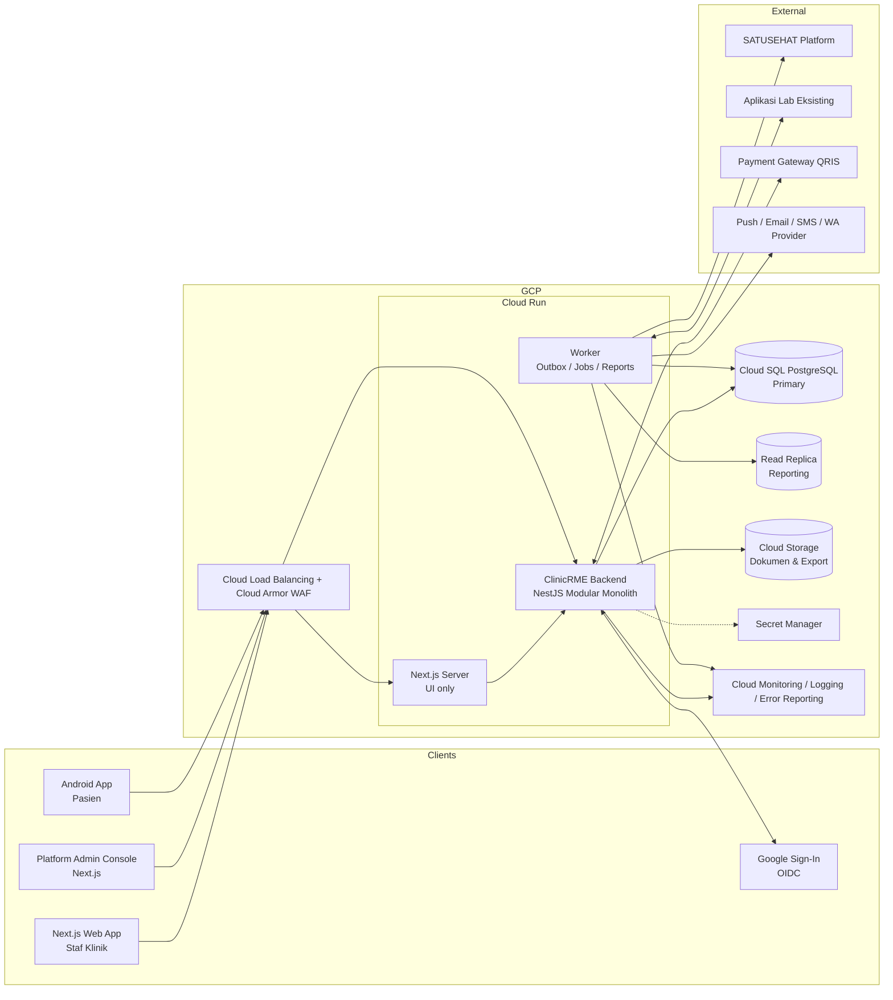
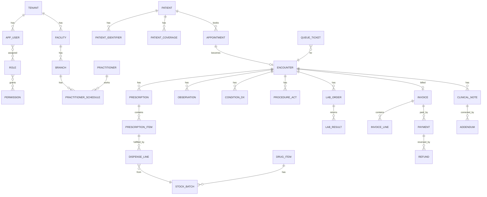

# Rancangan Aplikasi ClinicRME SaaS

| Atribut | Nilai |
|---|---|
| Dokumen | Rancangan Aplikasi (High-Level Design) |
| Versi | 0.2 — DRAFT |
| Tanggal | 3 November 2026 |
| Sumber | ROADMAP_PENGEMBANGAN_CLINICRME_SaaS v1.0 |
| Status | Menunggu review Project Owner |
| Perubahan v0.2 | Stack diganti ke NestJS + Next.js + PostgreSQL (ADR-0001); autentikasi Google OIDC + email/password langsung di NestJS (ADR-0003). Perubahan dari roadmap v1.0 dicatat di `00-governance/DECISION_LOG.md`. |

### Stack Teknologi (v0.2)

| Lapisan | Teknologi |
|---|---|
| Backend | Node.js LTS + **NestJS** (TypeScript), modular monolith |
| Web frontend | **Next.js** (App Router, TypeScript) — hanya UI, tanpa akses DB langsung |
| Database | **PostgreSQL** + Row-Level Security |
| Akses DB & migrasi | Drizzle ORM + Drizzle Kit (file SQL ber-versi) — atau Kysely (OD-054) |
| Job / outbox | pg-boss (antrean di PostgreSQL, tanpa Redis) |
| Validasi | Zod |
| API | REST + OpenAPI (`@nestjs/swagger`), client Next.js di-generate dengan orval |
| Autentikasi | Google Sign-In (OIDC) + email/password, MFA TOTP untuk admin — langsung di NestJS |
| Monorepo | Nx (pnpm) dengan aturan `enforce-module-boundaries` |
| Android | Kotlin + Jetpack Compose (tetap) |
| Infrastruktur | GCP Cloud Run (API, worker, web), Cloud SQL, Cloud Storage, Secret Manager |

> Dokumen ini adalah rancangan awal untuk dibahas. Semua yang ditandai **OPEN DECISION (OD-xxx)** belum diputuskan dan harus ditetapkan Project Owner sebelum stage terkait dimulai. Dokumen ini tidak mengklaim kepatuhan HIPAA, FHIR, maupun SATUSEHAT.

---

## 1. Ringkasan

ClinicRME adalah aplikasi Rekam Medik Elektronik (RME) berbasis SaaS multi-tenant untuk:

- **Klinik Utama**
- **Klinik Pratama**
- **Praktik Dokter Mandiri**

**Batas sistem:**

| Termasuk | Tidak termasuk |
|---|---|
| Registrasi, jadwal, antrean | SIMRS (rawat inap, kamar, IGD rumah sakit) |
| Rekam medis rawat jalan (SOAP, diagnosis, tindakan, resep) | Aplikasi laboratorium mandiri (LIS) |
| Farmasi klinik & inventori obat | Akuntansi umum / general ledger |
| Billing, pembayaran, kasir | Bridging BPJS — Lanjutan, bukan MVP (DEC-006) |
| Integrasi FHIR / SATUSEHAT | Telemedicine video (DEC-007) |
| Integrasi aplikasi lab yang sudah ada | |
| Aplikasi Android untuk pasien | |
| Report builder & dashboard | |

---

## 2. Pengguna & Peran

| Peran | Lingkup | Contoh hak akses utama |
|---|---|---|
| **Platform Superadmin** | Seluruh platform | Kelola tenant, paket, status langganan. **Tidak** dapat membuka data klinis. |
| **Platform Support** | Tenant tertentu, dengan izin | Akses diagnostik terbatas, berbatas waktu, teraudit (break-glass). |
| **Tenant Admin** | Satu tenant | Kelola cabang, pengguna, role, master data, tarif. |
| **Dokter** | Cabang yang ditugaskan | SOAP, diagnosis, tindakan, resep, pengesahan RM, rujukan. |
| **Perawat / Bidan** | Cabang yang ditugaskan | Triase, tanda vital, anamnesis awal. |
| **Petugas Pendaftaran** | Cabang | Registrasi pasien, appointment, antrean. |
| **Apoteker / Asisten Apoteker** | Lokasi farmasi | Telaah resep, dispensing, stok. |
| **Kasir** | Cabang | Invoice, pembayaran, closing shift. |
| **Manajer / Owner Klinik** | Tenant | Laporan, dashboard, persetujuan refund. |
| **Auditor** | Tenant, read-only | Audit log, laporan kepatuhan. |
| **Pasien / Wali** | Data milik sendiri | Aplikasi Android: riwayat, resep, hasil lab, dokumen, jadwal. |

Role bersifat **konfigurabel**: role di atas adalah template bawaan; tenant dapat membuat role sendiri dari kumpulan permission.

---

## 3. Arsitektur Sistem

### 3.1 Gambaran Umum



### 3.2 Gaya Arsitektur: Modular Monolith

- Satu aplikasi NestJS (`apps/api`) + satu proses worker (`apps/worker`, kode modul yang sama, entrypoint berbeda) untuk pekerjaan asinkron: outbox, SATUSEHAT, PDF, export laporan. Proses API tidak menjalankan pekerjaan berat karena Node berjalan single-thread.
- Setiap modul domain adalah Nx library terpisah; dependensi antar modul ditegakkan dengan aturan lint `@nx/enforce-module-boundaries` (tag `scope:<modul>`).
- Next.js (`apps/web`) hanya UI: tidak ada server action / route handler yang membaca database. Semua data lewat API NestJS agar otorisasi & audit berada di satu tempat.
- Komunikasi antar modul:
  - **Sinkron:** melalui public API modul (`index.ts` library yang mengekspor service & DTO tertentu), bukan akses langsung ke tabel/repository modul lain.
  - **Asinkron:** domain event via **transactional outbox** (tabel `outbox_event`), diproses worker.
- Pemisahan menjadi microservice hanya melalui ADR jika ada alasan terukur (beban, tim, isolasi kegagalan).

### 3.3 Modul Domain

| # | Modul | Package | Tanggung jawab | Stage |
|---|---|---|---|---|
| 1 | Platform | `platform` | Tenant, paket langganan, kuota, status tenant, branding | 5 |
| 2 | Identity & Access | `iam` | User, role, permission, menu, sesi, MFA, jadwal login, delegasi | 3, 6 |
| 3 | Audit | `audit` | Audit log append-only berantai hash | 3 |
| 4 | Master Data | `masterdata` | Fasilitas, cabang, unit, tenaga kesehatan, tarif, penjamin, satuan | 7 |
| 5 | Terminology | `terminology` | ICD-10, ICD-9-CM, kode KFA/obat, value set & versi | 7, 12 |
| 6 | Patient | `patient` | Master Patient Index, identitas, kontak darurat, consent, penjamin pasien | 8 |
| 7 | Scheduling | `scheduling` | Jadwal praktik, appointment, antrean, check-in | 8 |
| 8 | Clinical | `clinical` | Encounter, SOAP, vital, alergi, diagnosis, tindakan, resep, dokumen medis, pengesahan, addendum, rujukan | 9 |
| 9 | Pharmacy | `pharmacy` | Item obat, batch, stok, mutasi, dispensing, retur, opname | 10 |
| 10 | Billing | `billing` | Tarif snapshot, invoice, pembayaran, deposit, piutang, refund, kasir | 11 |
| 11 | Integration | `integration` | FHIR mapper, adapter SATUSEHAT, adapter lab, adapter payment gateway | 10–12 |
| 12 | Patient Portal | `portal` | API khusus aplikasi pasien, device, notifikasi | 13 |
| 13 | Reporting | `reporting` | Katalog data, report template, eksekusi, jadwal, export | 14 |
| 14 | Document | `document` | Penyimpanan berkas, generate PDF, tanda tangan | 9 |
| 15 | Notification | `notification` | Template & pengiriman notifikasi (tanpa data medis sensitif) | 8, 13 |
| 0 | Shared Kernel | `shared` | Tenant context, Money, ID, error, pagination, clock | 4 |

### 3.4 Struktur per Modul (Nx library)

```
libs/<module>/src/
├── index.ts              # Public API modul: service, DTO, event yang boleh dipakai modul lain
├── <module>.module.ts    # NestJS module
├── web/                  # Controller, request/response schema (Zod), dekorator OpenAPI
├── application/          # Use case / service, transaksi, pengecekan permission
├── domain/               # Tipe domain, aturan bisnis, domain event
└── infrastructure/       # Tabel Drizzle, repository, adapter eksternal
```

### 3.5 Struktur Repository (monorepo Nx + pnpm)

```
atoai-rme-v2/
├── apps/
│   ├── api/                 # NestJS HTTP API
│   ├── worker/              # NestJS standalone app: pg-boss jobs, outbox, integrasi
│   ├── web/                 # Next.js — aplikasi staf klinik
│   └── platform-admin/      # Next.js — konsol superadmin (bisa digabung ke web di awal)
├── libs/
│   ├── shared/              # tenant context (AsyncLocalStorage), db client, money, error, auth guard
│   ├── platform/  iam/  audit/  masterdata/  terminology/  patient/  scheduling/
│   ├── clinical/  pharmacy/  billing/  integration/  portal/  reporting/  document/  notification/
│   ├── ui/                  # komponen React bersama
│   └── api-client/          # client TypeScript hasil generate dari OpenAPI (orval)
├── db/migrations/           # file SQL ber-versi (Drizzle Kit), termasuk policy RLS
├── android/                 # Kotlin + Jetpack Compose (di luar Nx)
├── infra/                   # IaC GCP (OD-006)
├── docs/
├── docker-compose.yml
└── .github/workflows/
```

---

## 4. Multi-Tenancy & Isolasi Data

**Usulan model (OD-007):** *shared database, shared schema* dengan kolom `tenant_id` di setiap tabel milik tenant + **PostgreSQL Row-Level Security (RLS)**.

| Lapisan | Kontrol |
|---|---|
| Edge | Tenant ditentukan dari subdomain/domain atau klaim token; bukan dari input body. |
| Aplikasi | Tenant context disimpan di `AsyncLocalStorage` (nestjs-cls), di-set oleh guard dari sesi terverifikasi; ditolak bila tidak cocok dengan resource. |
| Repository | Semua query lewat helper `withTenantTx(fn)` yang membuka transaksi dan men-set tenant; lint/test melarang pemakaian koneksi DB di luar helper ini. |
| Database | `SET LOCAL app.tenant_id = '<uuid>'` di awal setiap transaksi (via `set_config('app.tenant_id', $1, true)`); policy RLS `USING (tenant_id = current_setting('app.tenant_id')::uuid)`; role DB aplikasi **bukan** owner tabel dan tidak punya `BYPASSRLS`. |

Contoh helper (Drizzle):

```ts
export async function withTenantTx<T>(db: Db, fn: (tx: Tx) => Promise<T>): Promise<T> {
  const tenantId = cls.get('tenantId');
  if (!tenantId) throw new UnauthorizedException('Tenant context missing');
  return db.transaction(async (tx) => {
    await tx.execute(sql`select set_config('app.tenant_id', ${tenantId}, true)`);
    return fn(tx);
  });
}
```
| Storage | Path objek `tenants/{tenant_id}/...`; akses hanya via signed URL berumur pendek. |
| Cache / job / report | Kunci cache & job selalu menyertakan `tenant_id`. |
| Log | `tenant_id` dicatat, data klinis tidak dicatat. |

Alternatif yang dievaluasi di Stage 2: schema-per-tenant, database-per-tenant untuk tenant enterprise.

---

## 5. Model Data Tingkat Tinggi

### 5.1 Konvensi

| Aspek | Konvensi |
|---|---|
| Primary key | `UUID` (usulan UUIDv7 untuk urutan waktu) |
| Kolom wajib | `tenant_id`, `created_at`, `created_by`, `updated_at`, `updated_by`, `version` (optimistic lock) |
| Waktu | `timestamptz` disimpan UTC; tampilan zona waktu cabang (WIB/WITA/WIT) |
| Uang | `numeric(18,2)`, mata uang IDR; di TypeScript diperlakukan sebagai string / `decimal.js`, **tidak pernah** dikonversi ke `number` |
| Hapus | Master data: soft delete/nonaktif. Data klinis & transaksi yang disahkan: **tidak dapat dihapus/diubah**, koreksi via addendum/reversal |
| Migrasi | File SQL ber-versi (Drizzle Kit generate, direview manual; RLS/trigger ditulis SQL langsung), forward-only; tidak ada edit migrasi yang sudah dirilis |
| Penamaan | `snake_case`, tabel jamak, prefix modul bila perlu (`pharm_`, `bill_`) |

### 5.2 Entitas Inti



Detail tabel, kolom, dan index ditetapkan di Stage 2 (`DATABASE_DESIGN.md`, `DATA_DICTIONARY.md`).

### 5.3 Siklus Status Utama

**Encounter (kunjungan):**
`REGISTERED → ARRIVED → TRIAGED → IN_CONSULTATION → CONSULT_DONE → PHARMACY → BILLING → FINISHED`
Cabang: `CANCELLED`, `NO_SHOW`. (Urutan farmasi/kasir dapat dikonfigurasi per tenant — OD-008.)

**Rekam medis:** `DRAFT → SIGNED (final, immutable) → [ADDENDUM*]`

**Resep:** `DRAFT → ISSUED → VERIFIED → PARTIALLY_DISPENSED → DISPENSED` | `CANCELLED`

**Invoice:** `DRAFT → ISSUED → PARTIALLY_PAID → PAID` | `VOID (via approval)`; `REFUNDED` sebagian/penuh via dokumen refund terpisah.

---

## 6. Rancangan API

| Aspek | Keputusan usulan |
|---|---|
| Gaya | REST JSON, OpenAPI 3.1 di-generate dari kode NestJS (`@nestjs/swagger`), spec hasil generate di-commit & dicek breaking change di CI |
| Versi | Prefix path: `/api/v1/...` (staf), `/api/patient/v1/...` (aplikasi pasien), `/api/platform/v1/...` (superadmin), `/fhir/r4/...` (bila endpoint FHIR diekspos — OD-009) |
| Auth | Lihat Bagian 7.1. Web: sesi cookie `HttpOnly` + `Secure` + `SameSite=Lax` yang dikelola NestJS. Android: access token pendek + refresh token rotasi per device. |
| Error | RFC 9457 Problem Details, kode error stabil (`PAT-409-DUPLICATE`) |
| Idempotency | Header `Idempotency-Key` wajib untuk pembayaran, refund, dispensing, pengiriman integrasi |
| Konkurensi | `ETag`/`If-Match` atau field `version` untuk update |
| Pagination | Cursor-based untuk daftar besar; page/size untuk master data |
| Rate limit | Per tenant & per user; batas lebih ketat untuk login dan export |

Contoh endpoint inti:

```
POST   /api/v1/patients                      # registrasi
GET    /api/v1/patients?q=&nik=&mrn=         # pencarian
POST   /api/v1/appointments
POST   /api/v1/queue/tickets
POST   /api/v1/encounters/{id}/check-in
PUT    /api/v1/encounters/{id}/soap          # draft
POST   /api/v1/encounters/{id}/sign          # pengesahan
POST   /api/v1/clinical-notes/{id}/addenda
POST   /api/v1/prescriptions/{id}/dispense
POST   /api/v1/invoices/{id}/payments
POST   /api/v1/payments/{id}/refunds
POST   /api/v1/integrations/payment/callback  # verifikasi signature
GET    /api/v1/me/menu                       # dynamic menu
```

---

## 7. Keamanan & Privasi (Ringkasan)

| Area | Kontrol |
|---|---|
| Autentikasi | Google Sign-In (OIDC) atau email/password; lockout; **MFA TOTP wajib** untuk admin tenant & platform, opsional/konfigurabel untuk klinisi (lihat 7.1) |
| Otorisasi | RBAC + permission granular (`clinical.note.sign`) + atribut (cabang, jadwal jaga, status akun); dicek **di backend** |
| Isolasi tenant | Lihat Bagian 4 |
| Enkripsi | TLS 1.2+ in transit; at-rest oleh Cloud SQL/GCS (CMEK: OD-011); enkripsi kolom untuk identitas sensitif (NIK) |
| Secret | Secret Manager; tidak ada secret di repo / image |
| Audit | Append-only, hash chain per tenant, mencatat siapa-apa-kapan-dari mana; termasuk akses **baca** rekam medis |
| Break-glass | Akses darurat dengan alasan wajib, berbatas waktu, notifikasi ke admin |
| Consent | Persetujuan pasien tercatat & berversi; pencabutan consent dihormati sesuai ketentuan |
| Retensi | Kebijakan retensi RM mengikuti ketentuan Kemenkes yang berlaku (diverifikasi di Stage 0/3) |
| Logging | Tanpa PHI di log aplikasi; masking otomatis |
| Supply chain | Dependency scanning, SBOM, image scanning |

### 7.1 Autentikasi (ADR-0003)

Implementasi sederhana, langsung di NestJS, tanpa IdP terpisah.

**Metode login staf:**
1. **Masuk dengan Google** — OAuth 2.0 Authorization Code + PKCE ke Google, scope `openid email profile` saja.
2. **Email + password** — cadangan untuk staf tanpa akun Google. Hash password dengan Argon2id.

**Alur Google:**

```
Next.js: tombol "Masuk dengan Google" → GET /api/v1/auth/google
NestJS : buat state + nonce + PKCE verifier (simpan di cookie terenkripsi) → redirect ke Google
Google : account chooser / login → redirect ke /api/v1/auth/google/callback?code=...
NestJS : tukar code → id_token; verifikasi signature (JWKS), iss, aud, exp, nonce, email_verified
       → cari user_identity (provider='google', subject=sub)
         · belum tertaut → hanya boleh jika ada undangan aktif untuk email itu → tautkan
         · tidak ada undangan → tolak
       → cek status akun, tenant, cabang, jadwal jaga
       → role admin & MFA belum diverifikasi → minta TOTP
       → buat sesi (tabel user_session) → set cookie → redirect ke Next.js
```

**Aturan:**
- Tidak ada pembuatan akun otomatis; user harus diundang tenant admin.
- Kunci penautan adalah `sub` Google, bukan email.
- Tenant boleh membatasi login Google ke domain Workspace tertentu (klaim `hd`).
- Menonaktifkan user di ClinicRME langsung mencabut semua sesinya, apa pun status akun Google-nya.
- MFA admin selalu TOTP milik ClinicRME, karena status 2-Step Verification akun Google pribadi tidak dapat dipastikan.
- Library: `openid-client` (atau `google-auth-library` untuk verifikasi id_token).

**Tabel:**

| Tabel | Kolom |
|---|---|
| `user_identity` | user_id, provider (`google`/`password`), subject, email_at_link, linked_at |
| `user_credential` | user_id, password_hash, password_changed_at, failed_attempts, locked_until |
| `user_mfa` | user_id, totp_secret_encrypted, recovery_codes_hash, enabled_at |
| `user_invitation` | tenant_id, email, role_ids, branch_ids, token_hash, expires_at, accepted_at |
| `user_session` | user_id, tenant_id, branch_id, mfa_verified, ip, user_agent, created_at, last_seen_at, expires_at, revoked_at |

**Pasien (Android, Stage 13):** Google Sign-In via Credential Manager boleh dipakai untuk login, tetapi penautan ke rekam pasien tetap memerlukan verifikasi OTP ke nomor yang terdaftar di klinik.

**Evolusi:** bila nanti dibutuhkan SSO perusahaan, SAML, atau kebijakan per tenant yang kompleks, pindah ke IdP (Google Identity Platform / Keycloak) melalui ADR baru; tabel `user_identity` sudah disiapkan untuk banyak provider.

---

## 8. Integrasi

| Integrasi | Pola | Catatan |
|---|---|---|
| **SATUSEHAT** | Outbox → worker → adapter; OAuth2 client credentials per fasilitas | Resource awal: Organization, Location, Practitioner, Patient, Encounter, Condition, Observation, Procedure, MedicationRequest, MedicationDispense, Composition (final ditetapkan Stage 12) |
| **Aplikasi Lab eksisting** | Adapter per vendor; FHIR ServiceRequest/DiagnosticReport atau API/HL7 v2 vendor | Order keluar, hasil masuk; matching via order number |
| **Payment Gateway QRIS** | Create dynamic QR → callback bertanda tangan → verifikasi → idempotent update | Rekonsiliasi harian dengan settlement report |
| **Notifikasi** | Worker; template tanpa info medis sensitif | Provider: OD-012 |

Semua integrasi keluar memakai: retry eksponensial, idempotency key, dead-letter queue (tabel `integration_dead_letter`), dashboard status.

---

## 9. Frontend

### 9.1 Web (Next.js)

- Next.js App Router + TypeScript strict; sebagian besar layar klinik berupa client component (aplikasi internal, SSR tidak kritis).
- Data fetching: TanStack Query + client hasil generate dari OpenAPI (orval, `libs/api-client`).
- Form: React Hook Form + Zod (schema dapat dibagi dengan backend).
- UI library: OD-013 (usulan: shadcn/ui + Tailwind CSS).
- **Dynamic menu** dari `GET /api/v1/me/menu`; `middleware.ts` hanya mengecek ada/tidaknya sesi — otorisasi tetap di NestJS.
- Tidak memakai NextAuth/Auth.js sebagai sumber sesi; sesi dimiliki NestJS (Bagian 7.1).
- Deploy sebagai container Cloud Run (`output: 'standalone'`), bukan Vercel, agar data tetap di infrastruktur & region yang dikendalikan.
- Layar utama klinik:
  - Dashboard harian cabang
  - Pendaftaran & pencarian pasien
  - Papan antrean (termasuk tampilan TV)
  - Worklist dokter → layar Encounter (tab: SOAP, Vital, Dx/Tindakan, Resep, Lab, Dokumen, Riwayat)
  - Worklist farmasi → telaah & dispensing
  - Kasir → invoice, pembayaran, closing shift
  - Master data, pengguna & role
  - Report builder & dashboard

### 9.2 Android (Pasien)

- Kotlin + Jetpack Compose, arsitektur MVVM + clean layers, Hilt (OD-014).
- Penyimpanan lokal minimal & terenkripsi; tanpa data medis di notifikasi.
- Fitur: login & verifikasi, riwayat kunjungan, resep, hasil lab, unduh dokumen, jadwal kontrol & pengingat, akun wali, kelola perangkat.

---

## 10. Non-Functional Requirements Awal

| ID | Kategori | Target awal (untuk divalidasi Stage 1) |
|---|---|---|
| NFR-PERF-001 | Latensi API | p95 < 500 ms untuk operasi transaksional |
| NFR-PERF-002 | Pencarian pasien | p95 < 1 s pada 1 juta pasien per tenant |
| NFR-AVL-001 | Ketersediaan | 99,5% bulanan (OD-015) |
| NFR-DR-001 | RPO / RTO | RPO ≤ 15 menit, RTO ≤ 4 jam (OD-016) |
| NFR-SEC-001 | Isolasi tenant | 0 kebocoran lintas tenant pada test suite isolasi |
| NFR-AUD-001 | Audit | 100% aksi tulis & baca RM tercatat |
| NFR-UX-001 | Bahasa | Bahasa Indonesia (EN opsional) |
| NFR-CMP-001 | Browser | Chrome/Edge 2 versi terakhir |
| NFR-AND-001 | Android | minSdk: OD-017 |

---

## 11. Lingkungan & Deployment

| Lingkungan | Tujuan | Data |
|---|---|---|
| `dev` | Pengembangan harian | Sintetis |
| `test` | Integration & automated test | Sintetis |
| `staging` | UAT, sandbox SATUSEHAT & payment gateway | Sintetis / anonim |
| `prod` | Produksi | Nyata |

Satu GCP project per lingkungan; IaC; promosi image yang sama dari staging ke prod.

---

## 12. Pemetaan Phase & Stage

| Phase | Nama | Stage | Hasil akhir phase |
|---|---|---|---|
| **A** | Inisiasi & Desain | 0, 1, 2 | Scope, requirement, arsitektur disetujui |
| **B** | Fondasi Teknis | 3, 4 | Kontrol keamanan inti & pipeline siap |
| **C** | Platform SaaS | 5, 6, 7 | Tenant, user/role, master data berjalan |
| **D** | Operasional Klinik | 8, 9, 10, 11 | Alur pasien end-to-end: daftar → periksa → obat → bayar |
| **E** | Integrasi & Kanal | 12, 13, 14 | SATUSEHAT, aplikasi pasien, pelaporan |
| **F** | Produksi | 15, 16, 17 | Infrastruktur prod, pilot, rilis |

Detail setiap stage ada di folder `docs/stages/`.

---

## 13. Daftar Open Decision

Tabel ini memuat open decision tingkat arsitektur. OD-019 s.d. OD-053 yang spesifik per stage tercantum di masing-masing file `docs/stages/STAGE_XX_*.md`.

| ID | Pertanyaan | Stage keputusan |
|---|---|---|
| ~~OD-001~~ | BPJS → **Diputuskan:** Lanjutan (DEC-006) | — |
| ~~OD-002~~ | Telemedicine → **Diputuskan:** tidak di versi pertama (DEC-007) | — |
| ~~OD-003~~ | Penegakan batas modul → **Diputuskan:** Nx `enforce-module-boundaries` (ADR-0001) | — |
| OD-004 | Monorepo atau multi-repo | 2 |
| ~~OD-005~~ | Build tool → **Diputuskan:** Nx + pnpm (ADR-0001) | — |
| OD-006 | IaC: Terraform, Pulumi, atau manual + dokumentasi | 2 |
| OD-007 | Model multi-tenancy: shared schema + RLS (usulan) vs schema-per-tenant | 2 |
| OD-008 | Urutan alur farmasi ↔ kasir dapat dikonfigurasi per tenant? | 1 |
| OD-009 | Apakah ClinicRME mengekspos endpoint FHIR publik, atau hanya klien FHIR | 2 |
| ~~OD-010~~ | Identity Provider → **Diputuskan:** Google OIDC + email/password langsung di NestJS (ADR-0003) | — |
| OD-011 | CMEK (customer-managed keys) untuk Cloud SQL/GCS | 3 |
| OD-012 | Provider notifikasi (FCM, email, SMS, WhatsApp) | 8 |
| OD-013 | UI component library Next.js (usulan: shadcn/ui + Tailwind) | 2 |
| OD-014 | DI & library Android | 13 |
| OD-015 | Target SLA ketersediaan | 1 |
| OD-016 | Target RPO/RTO | 1 |
| OD-017 | Versi Android minimum | 13 |
| ~~OD-018~~ | Urutan Stage 3/4 → **Diputuskan:** Stage 3 desain + PoC (DEC-008) | — |
| OD-054 | Query layer: Drizzle ORM (usulan) atau Kysely | 2 |
